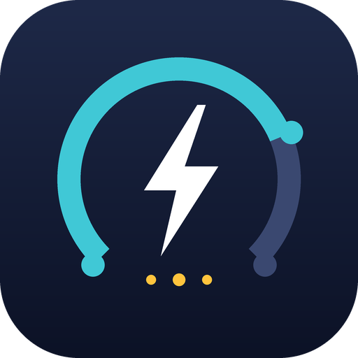

<p align="center"></p>

# Polestar Data Portal (EU Data Act) for Home Assistant

A Home Assistant custom integration that reads your vehicle data from the **official Polestar Data Portal API** (`data-portal.polestar.com`), the access Polestar provides to vehicle owners under the EU Data Act.

> **Status: beta (v0.2.3).** Written from the portal's API documentation, covered by offline unit tests, and confirmed working on one live account (first successful install). Other models and markets may report different fields: please report what you see.

- Read-only: no commands, no charging control.
- Uses the official OAuth2 client-credentials API (no scraping, no Polestar ID password stored).
- Not affiliated with Polestar. Unofficial community project.

## Requirements

- Home Assistant 2024.12.0 or newer
- A Polestar vehicle registered in an eligible EU/EEA market (the portal lists only those)
- A Polestar ID with access to the vehicle in the [Polestar data portal](https://data-portal.polestar.com/)

## Get API credentials

1. Sign in to the Polestar data portal.
2. Open **Credential** and create an API credential. Note the **Client ID** and **Client secret** (the secret is shown once; keep it private).
3. Open **API Documentation** and note the **Account ID / x-client-id**.

## Icon

The icon is original artwork (not Polestar's logo) in `custom_components/polestar_data_portal/brand/`. Recent Home Assistant versions use a `brand/` folder inside a custom integration for its icon; on older versions the integration shows the generic icon until it is added to the central brands repository.

## Install

**HACS:** HACS → ⋮ → *Custom repositories* → add this repository as type **Integration** → install → restart Home Assistant.

**Manual:** copy `custom_components/polestar_data_portal` into your `config/custom_components/` folder and restart.

Then: **Settings → Devices & services → Add integration → Polestar Data Portal**, and enter Client ID, Client secret and Account ID.

## Options

**Configure** on the integration lets you choose:

- **Polling interval** (default 5 min).
- **Data to fetch.** Each selected kind of data is one API call per vehicle per poll.

The portal allows **10,000 calls per client per day**. The options form refuses combinations estimated to exceed 9,000 calls/day. A diagnostic sensor, **API calls today**, shows the running count.

| Data | Default | Entities |
|---|---|---|
| Availability | on | availability status, usage mode |
| Battery and charging | on | battery %, range, charging status/type/power/current/voltage, time to full, consumption, energy breakdown (driving/climate/battery/other), discharge info |
| Doors, windows and locks | on | doors, windows, hood, tailgate, sunroof, central lock, alarm |
| Health | on | days/km to service, warnings, tyre pressures, light warnings (summary, disabled by default) |
| Location | on | device tracker, speed, altitude, heading |
| Odometer and trips | on | odometer, trip meters, average speeds |
| Charge target | on | target charge level |
| Parking climatization | off | status, cabin temperature, requested temperature, requested seat/steering-wheel heating, errors, warnings |
| Cabin pre-cleaning | off | status, air quality, last cycle |
| Charging current limit | off | amp limit |
| Charge Now | off | override status |
| Global charge timer | off | active, start, stop |
| At charge location | off | current charge location, arrival time |
| Charge locations | off | number of saved locations |

Entities are created only when your vehicle actually reports the field, so a model without a sunroof gets no sunroof entity. Some endpoints are model-specific and answer 404 for other models; the integration skips those for 6 hours and tries again.

Every sensor has a `reported_at` attribute with the timestamp the vehicle/portal reported for that data. The per-vehicle **Last update** sensor shows the newest one.

## Languages

Entity names and the setup/options texts are available in **English, Spanish, French and German**. Home Assistant picks the language automatically: setup and options dialogs use your user language, entity names use the language set in *Settings → System → General*. Any other language falls back to English.

Translations are managed in **Crowdin** (see `crowdin.yml`). To help translate or add a language, join the Crowdin project (link: *TODO*) and translate in the browser; no Git or JSON knowledge needed. Crowdin opens a pull request with the updated `translations/<lang>.json`.

## Is every field covered?

The catalog covers the fields documented for the 14 endpoints, apart from the pending-command objects and per-location charging profiles. Entities appear only when your car actually reports a field, and seven endpoints are **off by default** (see the table), so enable them under *Configure* to get more sensors.

To find out what your vehicle sends that isn't mapped yet:

- The diagnostic sensor **Unmapped fields** shows how many fields arrive without an entity; its `fields` attribute lists them as `endpoint.path`.
- *Settings → Devices & services → Polestar Data Portal → ⋮ → Download diagnostics* includes the same list and the redacted raw payloads.

Open an issue with those names and (if the value is a status string) the raw value, and the field can be added to `catalog.py` in one line.

## Known limitations

- **Enum values are not documented.** For status fields (charging status, warnings, door states …) the API documents plain strings without listing possible values. Text sensors show the raw value. Door/window/lock binary sensors interpret values containing *open/closed/locked/unlocked*; the raw value is always in the `raw_state` attribute, and the state stays *unknown* if a value isn't recognised. If you see unknown values, open an issue with the raw value.
- Individual light warnings are exposed only as a summary sensor (count + raw values in attributes, disabled by default) until the possible values are known. Charge timers, departure times and per-location charging profiles are not mapped yet.
- Units of the discharge-info fields are not documented, so they are shown without a unit.
- Data freshness depends on what the vehicle uploads; the portal only returns what the car has reported.
- The `x-client-id` header is sent on every request. The documentation marks it required for the vehicle list; whether other endpoints need it is not stated.

## Troubleshooting

- **Invalid credentials:** check Client ID, secret and Account ID; create a new credential if needed.
- **No vehicles:** only vehicles registered in an eligible EU/EEA market are listed.
- **Some entities missing:** the vehicle hasn't reported that field, or the model doesn't support that endpoint. Use **Download diagnostics** (redacted) to see which payloads arrive.
- Enable debug logging with:

```yaml
logger:
  logs:
    custom_components.polestar_data_portal: debug
```

## Development

```bash
python3 -m unittest discover -s tests -v      # offline tests, no Home Assistant needed
python3 tools/build_translations.py           # regenerate strings.json and translations/en.json (source for Crowdin)
python3 tools/make_icon.py                    # regenerate brand/ icons (needs Pillow)
```

Entities are defined in `custom_components/polestar_data_portal/catalog.py`; adding a field is one line there, followed by `python3 tools/build_translations.py`. Only the English files are generated; other languages are updated through Crowdin (untranslated texts fall back to English meanwhile). Do not hand-edit `translations/<lang>.json` for non-English languages; Crowdin would overwrite the edit.

## License

MIT
